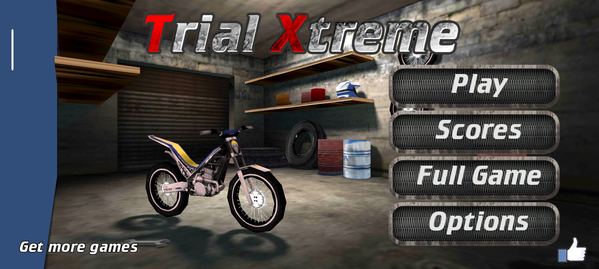
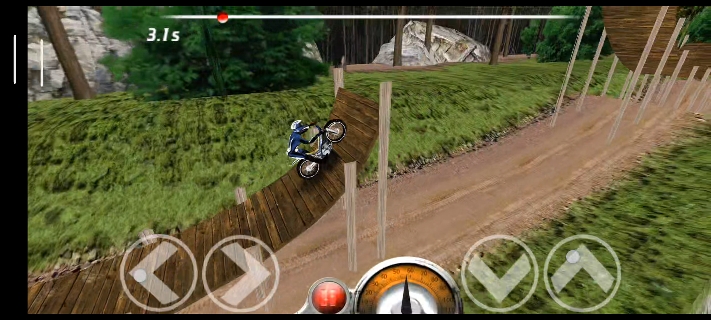
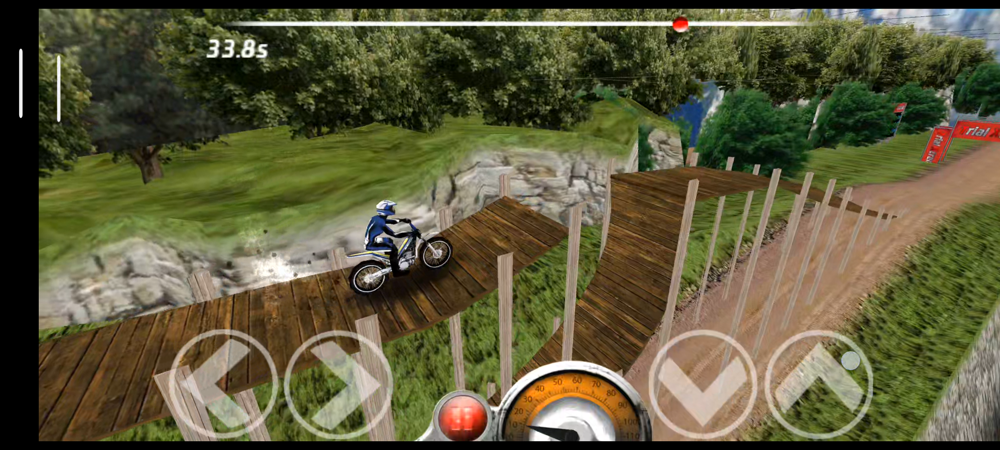
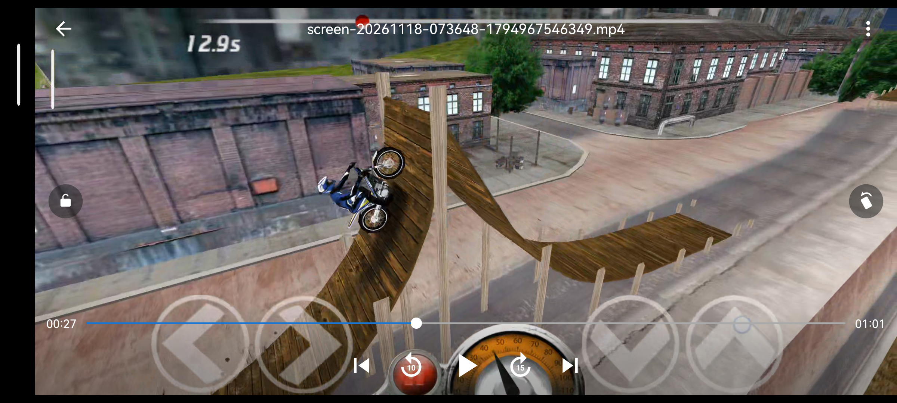
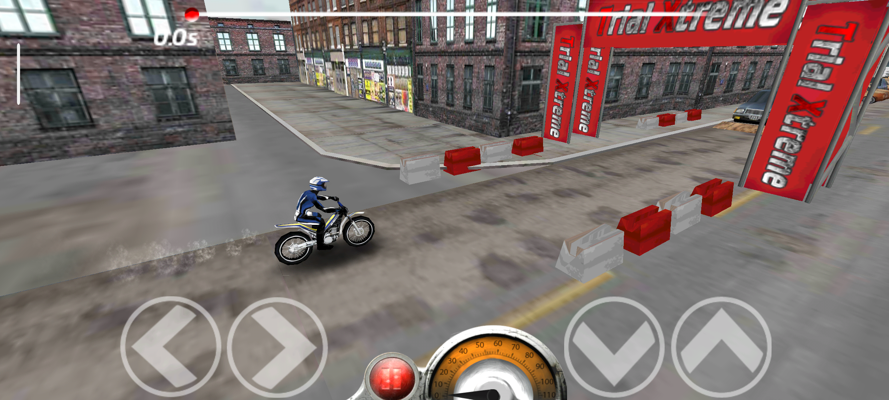

# Trial-Xtreme-1
Revived by IX32PSL.

Rules (like fight club):
1.Never talk about this. this is for safety and prevent takedowns.

Hello!
well here's the game launcher only. ;)
it's just install and play.

*How it works:*
IX32PSL is a Shim layer, based on Dynarmic. that acts as a JIT TRANSLATION LAYER 
and the Shell between 32-bit game codes and the Latest Android versions for Modern phones.

It's not for this game only, many games is being and will be revived by this project.
this is the just the first one.

So thanks and consider contributing if you are an enthusiast or A modder or A dev.
### Gallery

   

   

   

   

   

   

